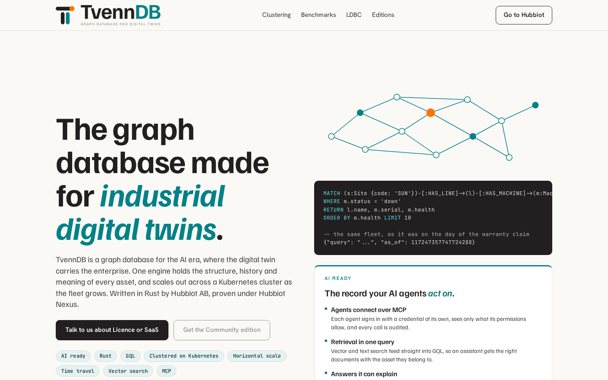

# TvennDB design

How TvennDB looks: the logo, colours, type and the page patterns of the TvennDB
page on [hubbiot.com/tvenndb](https://hubbiot.com/tvenndb/). Use it for the
Explorer, documentation, release notes, slides and anything else that carries the
TvennDB name.

TvennDB is a product of Hubbiot AB and is built on the Hubbiot design system:
the same typefaces and brand colours, with a few TvennDB rules on top. The
biggest difference is the accent. Hubbiot pages use orange accents. TvennDB
pages use teal accents and keep orange for the logo's node and other small marks.

| Path | What |
|---|---|
| [`../images/logo/`](../images/logo/) | The logo kit: every version and colour as SVG and PNG, plus the favicon set. Its [README](../images/logo/README.md) has the logo rules. |
| [`css/hubbiot-ds.css`](css/hubbiot-ds.css) | The Hubbiot base: fonts, colour and type tokens, and the `hb-` classes (eyebrow, headline, lead, card, chip, list, panel). |
| [`css/tvenndb.css`](css/tvenndb.css) | The TvennDB layer, scoped to `.tv-page`: teal accent, kicker, buttons, code block, panel, ink card, footer, header. |
| [`fonts/`](fonts/) | Self-hosted woff2 files, licensed under the SIL Open Font License 1.1 ([`OFL.txt`](fonts/OFL.txt)). |
| [`reference/`](reference/) | Screenshots of the live page: the top, and the full page. |

To use it on a page, load `css/hubbiot-ds.css`, then `css/tvenndb.css`, and
wrap the page in `
`.

## Logo

The symbol is a T: one record (the bar) carried by two stems, the physical
asset and its digital twin. The orange node marks the record. *Tvenn* is Old
Norse for twin or pair.

- Use the horizontal logo by default, and the tagline version (GRAPH DATABASE
  FOR DIGITAL TWINS) on covers and product pages. Don't show the tagline version
  below 48 px tall.
- Use `on-light` on paper or white, `on-dark` on deep teal or ink.
- Keep clear space equal to the bar's height on every side. Minimum size: 24 px
  tall for the horizontal logo, 16 px for the symbol.
- Don't recolour, stretch or retype the logo. Orange is only for the node.
- Write the name as **TvennDB**: one word, capital T, capital DB.

## Colour

| Token | Value | Role on TvennDB |
|---|---|---|
| `paper` | `#FBF9F6` | Page ground. Never pure white for the page. |
| `white` | `#FFFFFF` | Cards and panels on paper. |
| `ink` | `#231F20` | Text, primary buttons, code blocks, the SaaS card and the footer. |
| `body-2` | `#4A4A4A` | Lead and body text on paper. |
| `muted` | `#6B6B6B` | Captions and small notes. |
| `rule` | `#E5E1DB` | 1 px hairlines between everything. |
| `teal` | `#008287` | The accent: the italic word in a headline, the panel's top rule, hover on buttons. Display size only on paper (4.4:1). |
| `teal-text` | `#007479` | Teal for small text: links, eyebrows, labels. |
| `teal-tint` | `#E6F1F1` | Chip fill. |
| `orange` | `#FF7400` | Small marks only: the logo's node and the kicker's dot. Never text. |
| `deep-teal` | `#002F31` | Dark ground for the logo and favicon tiles. |
| `light` | `#DBD5D6` | Text on ink. |
| `light-2` | `#A9B6B5` | Secondary text on ink, comments in code. |
| code keyword | `#4FC3C7` | GQL keywords in code blocks on ink. |

## Type

| Role | Family | Notes |
|---|---|---|
| Headlines | Familjen Grotesk 600–700 | Tight leading (1.02–1.06), tracking −0.02 to −0.03em. One word in teal italic. |
| Body and lead | Familjen Grotesk 400 | Lead 19 px on the web, body 15 px. |
| Eyebrows | Chakra Petch 600 | Uppercase, tracking 0.16em. |
| Buttons, navigation, captions | Hanken Grotesk 500–600 | Buttons 15 px. |
| Code, chips, data | JetBrains Mono 400–600 | Code 12.5 px, leading 1.55. |

## Page patterns

- **Teal accent word.** Each headline has one word or phrase in italic teal:
  "The graph database made for *industrial digital twins*."
- **Kicker.** Section eyebrows start with the symbol's bar and its orange node
  (`.hb-eyebrow.tv-kicker`), followed by the uppercase label: THE CORE,
  BENCHMARKS, EDITIONS.
- **Buttons.** The primary button is filled ink (`.tv-btn--fill`), the secondary
  one is an ink outline (`.tv-btn--line`). Both turn teal on hover. On ink,
  use the light button (`.tv-btn--light`). Corners are 9 px.
- **Code on ink.** Queries sit in an ink block with 10 px corners
  (`.tv-code`): keywords in `#4FC3C7`, comments in `light-2`.
- **Panel.** White, a 1 px rule and a 3 px teal top rule (`.tv-panel`), for
  short lists such as "AI ready".
- **Cards.** White Hubbiot cards (`.hb-card`) on paper. In a row of
  editions, the hosted (SaaS) edition is the one ink card (`.tv-card-ink`).
- **Chips.** Mono, sentence case, teal-tint fill: `Rust`, `GQL`, `Time travel`.
- **Graph motif.** Small circles joined by thin teal lines, one node in
  orange: the Hubbiot ornament, also used in the TvennDB hero.
- **Method notes.** Benchmark methods sit in a closed `
`
  (`.tv-method`) under the chart, opened by a teal summary line.
- **Header and footer.** A sticky paper header with the tagline logo, in-page
  links and one outline button to Hubbiot. An ink footer with the `on-dark` logo
  and the trademark line: "TvennDB is a product of Hubbiot AB, Stockholm,
  Sweden. The TvennDB name and logo are trademarks of Hubbiot AB."

## Voice

Plain and specific. Say what the database does and how it was measured, not how
it feels. The legal entity is **Hubbiot AB**.

The TvennDB name and logo are trademarks of Hubbiot AB. The fonts are under the
SIL Open Font License 1.1.
